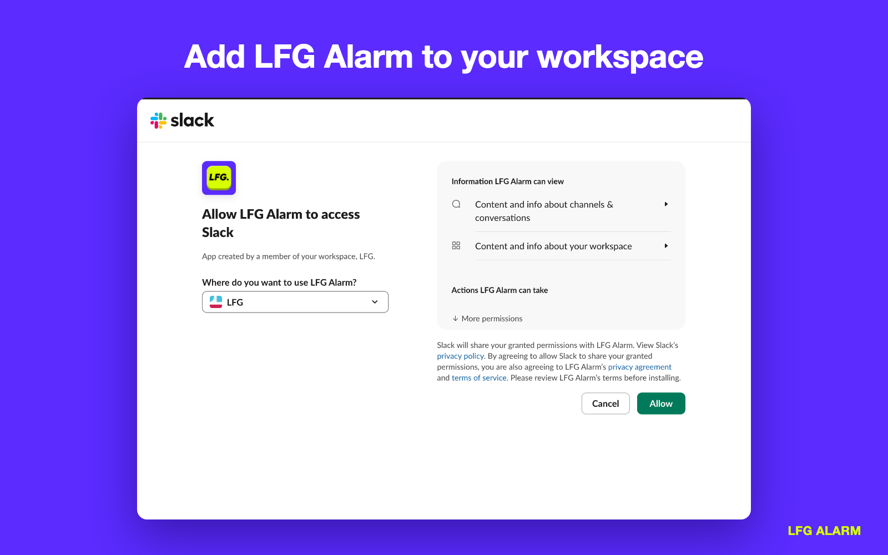
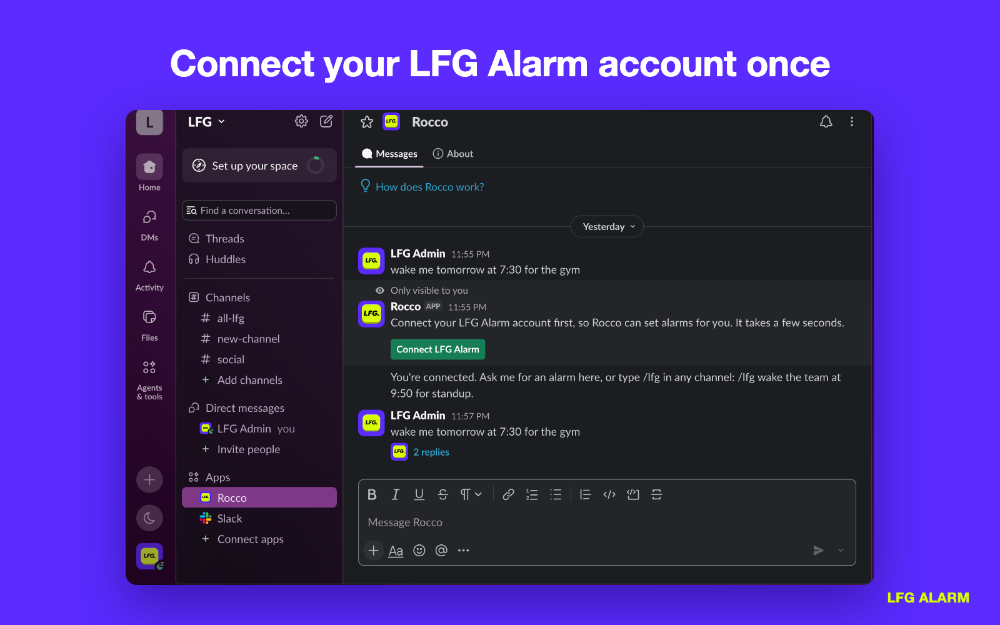
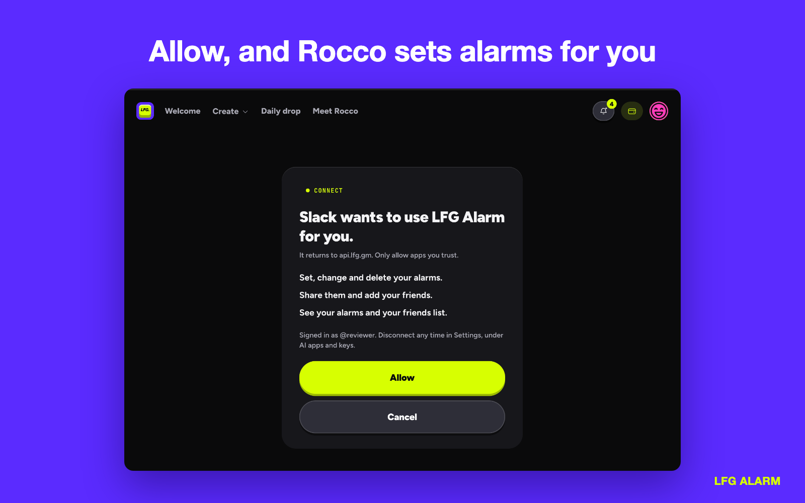
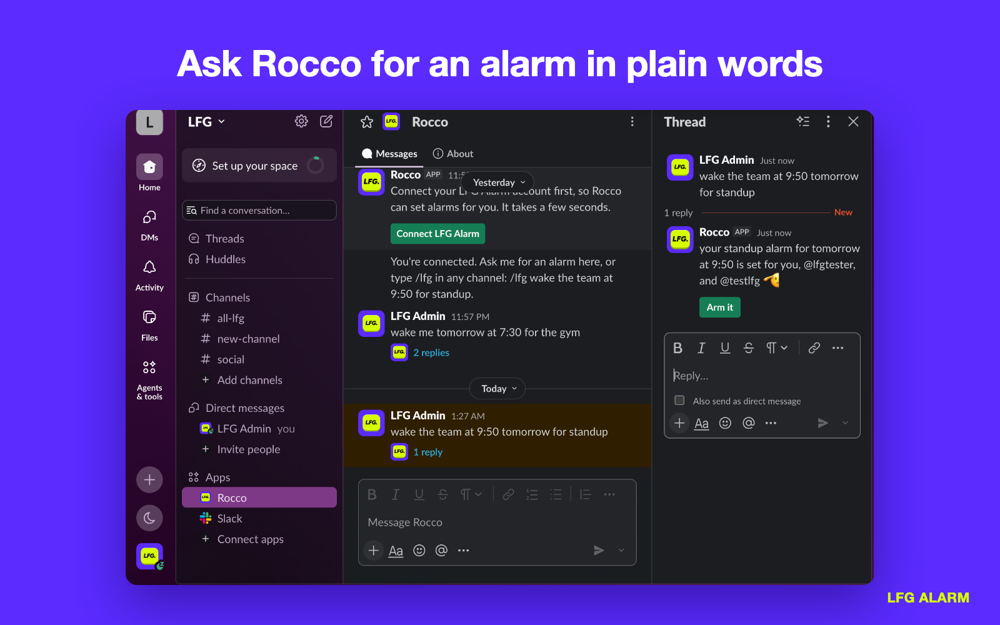
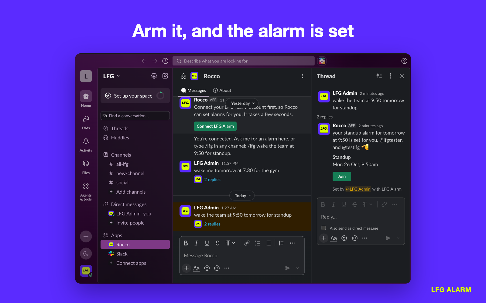
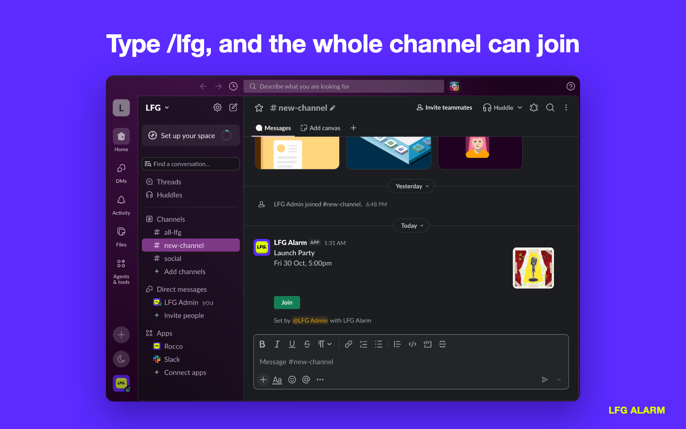
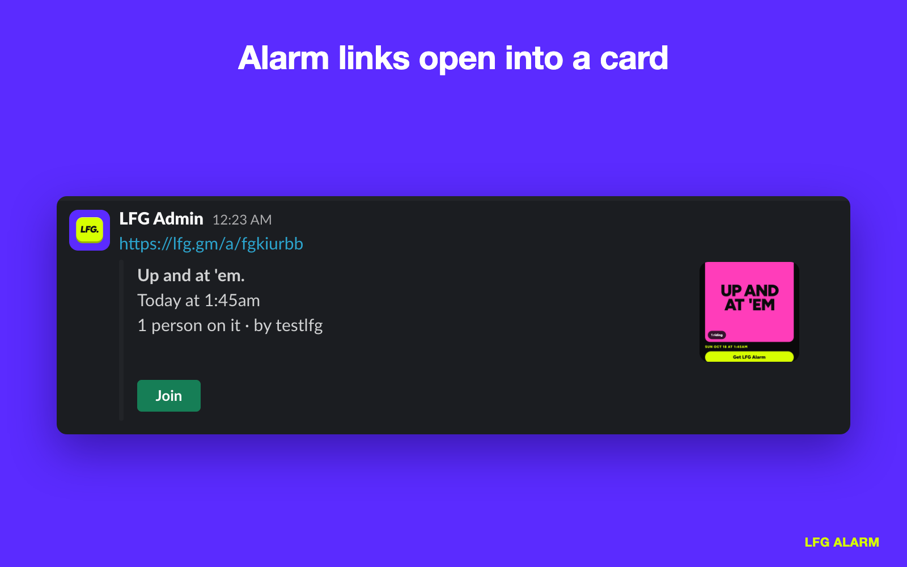

# LFG Alarm for Slack

Add it to a workspace: https://api.lfg.gm/slack/install

## Installing and connecting

1. Add LFG Alarm to your workspace.

   

2. The first time you ask Rocco for an alarm, he shows Connect LFG Alarm. Sign in on lfg.gm and press Allow.

   

   

## Using it

3. Ask Rocco in a direct message, or @mention him in a channel. He answers with what he will set and an Arm it button.

   

4. Press Arm it. The alarm is made on your LFG Alarm account, and its card posts with a Join button.

   

5. In any channel, type `/lfg` and what the alarm is for. Rocco's answer is visible only to you; once you arm it, the card posts for everyone.

   

6. Paste an lfg.gm alarm link and it opens into the alarm's card.

   

Support: support@lfg.gm
